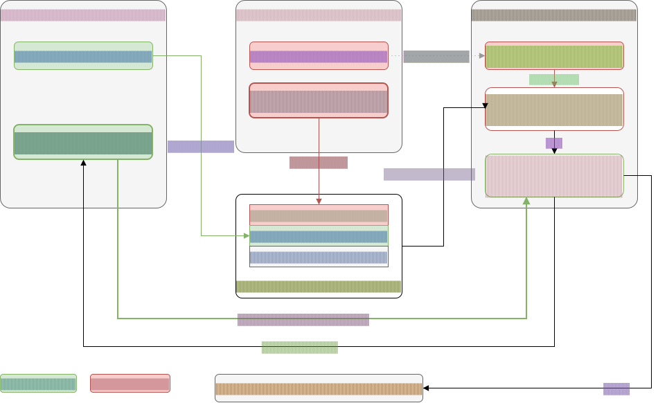
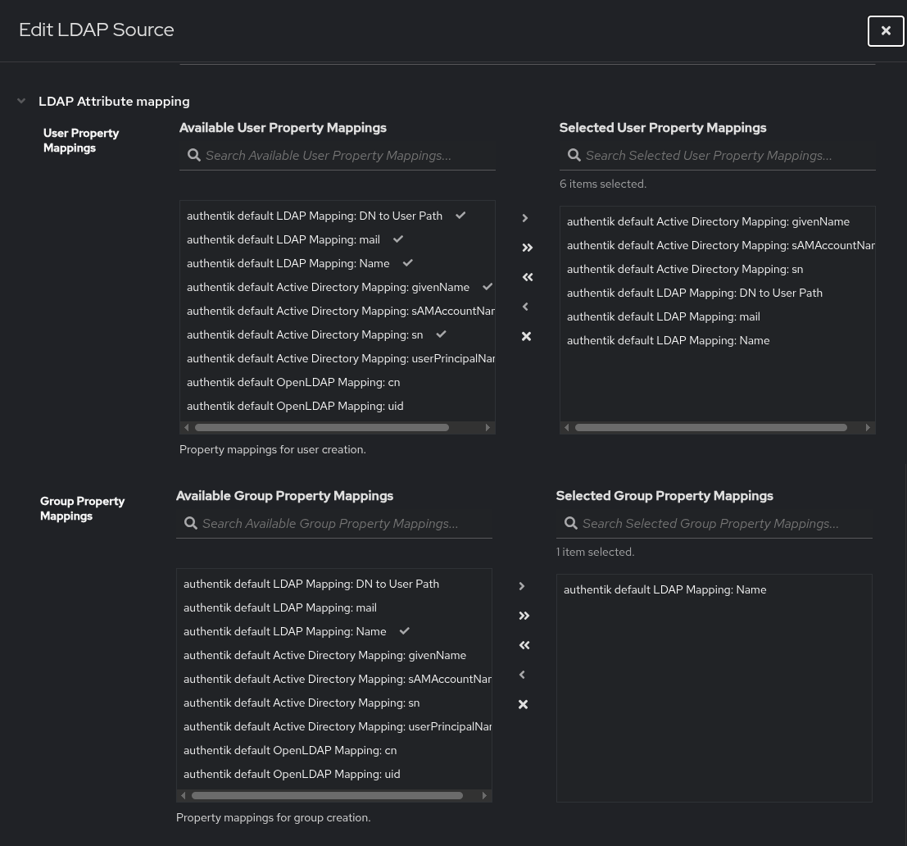
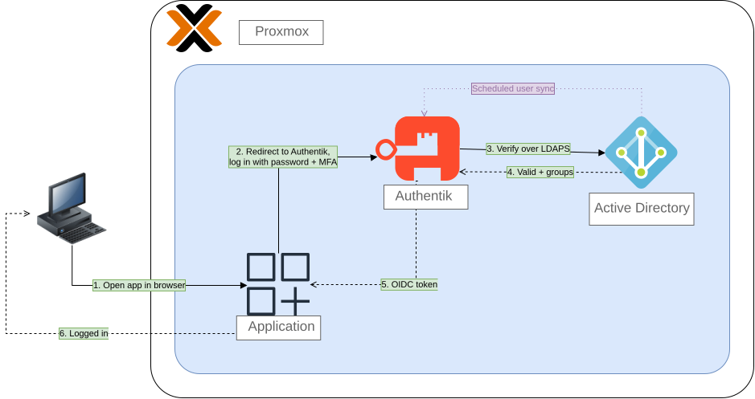

This is the most recent addition to my labs. I have been having issues related to passwords within my lab, everything has a different password and I've learned that my naming conventions aren't the best. This leads to me losing accounts within my password manager and sometimes I just leave the default password or use an easy to remember password simply so I don't have to deal with it. I've been doing the same thing with SSH access, I rarely ever SSH into my systems simply because I despise having to go through the setup process of setting a secure baseline using SSH keys, disabling password authentication, generating SSH keys, etc. I realized that I needed a simpler way to login to my applications, and access my systems through SSH that is also secure but easily scalable so I actually use the system now and in the future. That is when I started experimenting with SSO for my applications, but also Ansible to quickly setup secure SSH access to the systems themselves.

My original idea was just "setup SSO" which honestly is not that hard to do, unless you're me and tend to overcomplicate everything. I originally intended to just use Authentik for SSO and not introduce any complexity, but then I thought that I could tie in Active Directory and get some experience with that. Then I realized that the best way to handle account creation would be to join my Linux hosts to my domain, which would use LDAP for identity lookups. But wait, LDAP is unencrypted, so obviously I'd have to use AD CS to stand up a certificate authority and use LDAPS instead! Then I realized that if I am joining devices to the domain, joining each device manually would be a pain so I wanted a way to automate this, which led me to Ansible. Now obviously my playbooks would need to live somewhere, so I might as well self-host gitea and store my playbooks on there since I don't like the idea of keeping it on GitHub. Of course, if I'm self-hosting Gitea, I might as well sync everything on my GitHub to Gitea so I can have a copy of everything should something happen to my GitHub account! Wait though, everything relies on one domain controller and one DNS server, what happens if one of those go down? Guess I'll have to setup a fallback for both!

As you can see, I way over-engineered this, but it works and it was fun so if you're interested in how I set everything up and all the nights I spent debugging trivial issues, read on!

## What's the plan?

My plan is simply to set up SSO (Single Sign On) within my lab. I have never seriously looked into it but I have heard of a couple different apps like Authentik and Authelia that handle SSO. I had a couple pre-requisites for the app I wanted to use, namely being expandable and adaptable to different use cases as well as having LDAP support. This is because I planned on massively over-engineering this whole setup and make use of Active Directory as my identity provider. Authentik works just fine as an identity provider, especially when I am the sole user and Authelia may work even better due to how lightweight it is, but I've never gotten any hands-on experience with Active Directory so I figured this would be as good a time as any to really dig in and learn how to use it. I also figured that if I do decide to add more users to my lab in the future, Active Directory would scale much nicer in the future than just using base Authentik. So my idea was to have Authentik sync user accounts from Active Directory and then I'd use OIDC or SAML for each application to connect it to Authentik. So the flow would then be: User visits application which redirects to Authentik -> Authentik asks for password if session isn't valid -> Authentik looks up your user record in AD and chooses whether to reject or approve -> Authentik authorizes the app and the OIDC flow proceeds from here.

For SSH, the original idea I had is that I would create a SSH key and use Ansible to upload that key to every newly created virtual machine that I would want SSH access to. Thinking it through a little more I realized then that having access to that one key would essentially grant access to all my machines and that sounded a little riskier than I'd like. I then considered maybe using Ansible to somehow automatically create a SSH key for every new machine and then adding the required key to the machine I'll be SSH'ing from. With that solution though, I'm essentially right back where I started with several different passphrases for each key and seeing as the whole point of this project is to make use of SSO and making accessing all my machines and applications easier, that seemed like it was a sloppy solution. Doing a bit more digging, I learned that SSH certificates existed and would actually integrate nicely with Authentik.

The way this would work is I would utilize step-ca to issue short-lived certificates that I would then use to SSH into my machines. Now this whole keypairing thing has been something that has been extremely hard for me to wrap my head around but I think I've got a solid understanding of how it works in my setup so I'll try to explain it here. First there are two keypairs, the first keypair is a local keypair generated on my client device using step (which I'll refer to as "my" key), this is generated upon me trying to SSH in. Now this key is generated so that after I successfully authenticate using Authentik, step-ca running as a LXC within Proxmox, will then take my public key and "wraps" it with the appropriate data (identity, principals, expiry time) and signs it all into a certificate. The second keypair is step-ca's keypair. Each device has step-ca's public key that is read from `sshd_config` and step-ca holds the private key that it mints certs with. This is the same private key that created the cert with my public key. From here, the newly signed cert with my public key is presented to the target device and the public key on the target checks to see if the signature is valid to ensure I am properly authenticated. From there, the target uses a challenge-response technique to prove I am who I say I am. This challenge-response technique is done in order to prevent sending over the private key itself, which would defeat the whole point of this setup. This is done by the target device extracting the public key from the certificate, and challenging my client to sign some data using my local private key. After signing, my client sends over the signature back to the target device and uses the extracted public key to verify the signature. If the signature is valid, then I've successfully proven that I did not steal the cert from someone else. After both checks are approved, I am now successfully SSH'ed in! I've provided a diagram so you can visualize this.

The benefits of this setup is that I take advantage of SSO like I've been wanting to this entire time, but also stealing SSH certificates is just not really a thing. Since each certificate is short-lived, even if some malware were to steal the certificates and use that to login, they will eventually expire minimizing the exposure. Malicious info stealers generally steal everything they can, including certificates, SSH keys, and passwords and this approach is pretty resistant to all of them. Even if my password is stolen, MFA makes it hard to login even with the password, stealing the certificates after it's authenticated will have it eventually expire, and the process of logging in is nice and easy. The biggest risk would be if the step-ca's private key were to get stolen, since that'd essentially give the keys to the kingdom and allow anyone to forge certificates and authenticate against my devices. While it is something to keep in mind, all the risk is now concentrated in one device so I can focus on locking down step-ca as much as possible and put most of my attention there instead of dividing my attention to every single device. This is important to me since, as my lab grows, I will have to put more and more time in maintaining it and securing it so concentrating all the attention into a handful of devices rather than 20+ is beneficial at the administrative end.

## The Cons

There are a few cons that are introduced with this setup. The main one and most obvious one is that everything now depends on Active Directory being up. If it ever goes down for whatever reason, then I'll pretty much be unable to login into anything. I plan on mitigating this by introducing break-glass accounts that use SSH keys. Now this seems a bit ridiculous at first since I'm going through this whole process to prevent having to use long-standing credentials, but this is preferable to being locked out entirely with no way to fix something. I plan on setting up monitoring rules for these break-glass accounts that will alert me to any successful authentication, if it was me then I'd simply rotate the password once I'm done and go on about my day. If it's not me, then I know I have some sort of breach and the threat actor has access to the device and I can shut them out. I could do this from the very beginning instead of going through the whole SSO process, but these break-glass accounts are really meant to be something I rarely use, so the convenience of SSO still wins here. Besides the break-glass accounts I have two domain controllers setup each pointing at each other and on separate devices, so that if a domain controller DOES go down it will fall back to the other. Now this doesn't protect against something like a loss of power, but if one of my domain controllers runs into some critical error and I don't realize it, at least authentication can continue while I troubleshoot the issue. I also have to setup two DNS resolvers in the same configuration for the same reason.

The second con is that this is WAY overkill. I touched on this a little earlier in the introduction but I am honestly going a little overboard considering I am the only user and everything I run is only accessible through VPN. My threat model is virtually non-existent and I am introducing a ton of upkeep and maintenance. I answer that point with two simple things: it's fun to go way overboard and it's a learning experience. The way the current IT industry is now, it's very difficult to get hands-on experience with a lot of these softwares, yet most jobs want you to have hands-on experience creating a bit of a chicken and egg situation. I decided to solve that by trying to mirror my lab to an enterprise layout while also balancing my needs, this introduces the complexity that an enterprise setup has. It is definitely a drawback but I enjoy the tinkering and troubleshooting aspect of everything and if it gets me experience that's even better. Active Directory was the big one that I've been wanting to get experience with, especially basic things like creating user accounts, resetting passwords, messing with permissions, etc.

Now that I've laid out my plan and noted down some of the cons, I'll go through the setup process, the challenges I faced and how I fixed them, and try to walk you through my thought process while designing everything

## Getting Started

The obvious first thing to setup would be the domain controller. As I mentioned previously, I chose to use Windows Server 2025 as my domain controller since I wanted to use Active Directory. Installing Windows Server 2025 was relatively easy, I did have to follow some extra instructions to mount an extra drive containing the VirtIO drivers. This was necessary for Windows Server to recognize the virtual disk and begin the installation process. After installing the OS, I then needed to install the network drivers, once again using the VirtIO drivers. The process was simple enough, but extremely tedious since the installation process took quite a bit of time and I had to reinstall the OS multiple times due to my tendency to break things.

After installing the OS and the drivers, it was now time for me to install Active Directory and promote the server to a domain controller. To do this you have to fill out a few settings that sound pretty similar to each other (at least to me) for a successful promotion, namely the root domain name and the NetBIOS name. See, I wanted a bit of a theme with my domain controllers and wanted to name each domain controller after a different planet, with the first one being named after Pluto. (Sidenote: Pluto IS a planet and deserves a spot in our solar system. Any other opinion is simply incorrect.) I didn't really know what the NetBIOS name was and just figured it was like the hostname of the computer. I was under the idea that when setting up the second domain controller and joining it to the domain, I would name it Jupiter to go along with the planet theme, and if I ever saw Jupiter when logging in, then I knew that Pluto had failed for some reason and had to fallback to Jupiter. If you know anything about how AD works, then you know that is simply just not how it works at all and I completely misunderstood AD but at the time I thought it made sense. Additionally, since I didn't understand how difficult it would be to change the NetBIOS name, I simply decided to name it AD and I'd change it later. This would come back to bite me.

Now that I have the domain controller setup it was time to setup Authentik. Connecting authentik first required me to create a service account. This service account is what Authentik would use to connect to AD and read/sync the directory. Now I could've theoretically loosened up settings to allow for anonymous binds or use the admin account instead of creating a new account but I decided to use a service account for two reasons. 1. It follows best security practices since I am not giving the application admin access, and I am able to scope the permissions of the service account according to principles of least privilege. This also helps with attribution, since I am the only user at the moment, if I notice any logins that I didn't do myself I know that I have a problem. Letting an app use the admin account could cause it to authenticate using that account whenever it needs to, meaning I can't differentiate between the app logging in or a security breach. 2. I wanted to learn how to create a user within AD. This is self-explanatory, working with user accounts within AD is something I've been meaning to learn for a while so this was the best opportunity to do that.

After creating the service account, I then needed the base DN. The base DN is just used to tell Authentik what directory we will be syncing to. This is found pretty easily by just going into AD-UC, right clicking the directory to be synced and selecting Properties, and then click on Attribute Editor. From there just scroll until you find distinguishedName (DN) and then pasting that into Authentik. Authentik then asks for User Property Mappings and Group Property Mappings which is as simple as selecting the Property Mappings and moving them to the right side.

Every guide I found online said for both User and Group mappings, you only need to select everything that mentions anything with LDAP or Active Directory in it. I decided for testing purposes, I'd select everything to make sure it works and then I'd scope things down accordingly. After doing this, Authentik successfully recognized the domain but when trying to sync the directory, it kept failing with error `52e`. Googling this error revealed that it is an invalid credentials error, so I figured that maybe something was wrong with the credentials of the service account I setup and I'd simply change it to something extremely simple while I test, but even after doing this I kept receiving the same error. To rule out an issue with the account, I decided to try to login to the domain controller using the service account and to my surprise it worked without issue. I suspected I may be having a permissions issue and I decided to adjust the Default Domain Policy to be extremely open with the intent of testing connectivity and restricting permissions if things worked out. This still didn't solve my issue and I was now running out of ideas. I turned to Claude which made some recommendations that didn't seem like they'd solve anything to me until it suggested to turn on failure auditing and try to get a more in-depth log message. This made sense to me since I kept receiving the credentials error even though I knew they were correct, so after turning on failure auditing that's when I learned of the mistake I made. Earlier on, when I mentioned renaming the domain from AD to Pluto, I was warned by Claude that this was destructive and not recommended but I proceeded anyways. After renaming the domain, everything appeared fine so I proceeded thinking that Claude was simply over-exaggerating. The logs revealed that despite me changing the name, Authentik was still trying to authenticate using the old AD NetBIOS name. I couldn't figure out how to fix this and seeing as I couldn't predict how else this could affect me in the future, I decided to start over on a fresh install so I wouldn't be working on an unsteady foundation.

I then had to go through the tedious process of reinstalling Windows Server since I also have a bad habit of not taking a snapshot of the fresh install and rolling back to that. While reinstalling I also decided that I knew I  wouldn't mess up again and taking a snapshot was unnecessary. So after reinstalling and promoting the domain controller again, I somehow got locked out. I used a password from my password manager as the domain controller account password and a separate one for the DSRM password and neither password worked after the reboot. I then thought of trying to regain access using the DSRM password but after seeing that it was a slightly more involved process and I wasn't even sure which password was the correct one, I decided to reinstall again. I then thought maybe I should take a snapshot after reinstalling THIS time. Of course, I didn't do that but the next attempt was actually successful!

## Success at Last!

Now that I have an actual working instance of Active Directory setup, I added it back into Authentik and FINALLY got past the dreaded error `52e` and ran into a different error: `strongerAuthRequired`. I knew this meant that it wouldn't authenticate without first setting up LDAPS but I decided that I would disable LDAP signing so that I can rule out any issue related to that and simply authenticate using LDAP for testing and enable LDAPS once I confirmed it to be working. I hadn't looked into how LDAPS gets setup and I was concerned I would break something on the setup that would be confusing to diagnose so I figured it'd be better to confirm that Authentik could sync the directory through LDAP first, and if that worked then I would know any issues that arise after would be directly because of LDAPS. Doing this was surprisingly tricky since Microsoft doesn't exactly make it clear on how to do this for obvious reasons. From googling, I knew that I had to disable an option referencing something about LDAP server signing but when I found the option, I found two very similarly named ones. Nothing I found online referenced the "Enforcement" option but I decided since it also referenced LDAP I'd simply disable both. After disabling both settings and running `gpupdate /force` I finally managed to connect and the sync accounts task completed successfully but no accounts showed up. I expected to at least see the service account but the sync task would simply run successfully and not pull anything in. Doing some Googling revealed the issue, which was simply that in an attempt to mitigate any issues by selecting all group property mappings, I unintentionally caused Authentik to not find anything at all. Reading the documentation explicitly says to only select "authentik default LDAP Mapping: Name" for group mappings and after listening to the documentation, accounts were now syncing into Authentik. Now all that was left was to enable LDAPS.

*Diagram of authentication flow of applications*

## LDAPS

Setting up LDAPS was surprisingly easy. I knew I would need certificates for SSH certs and I setup step-ca in a LXC using a Proxmox helper script and left it up until I would need to use it. I figured I'd use step-ca to generate a certificate for LDAPS but I learned that this was a difficult process that would require considerable maintenance to maintain and that the much simpler path would be to use AD Certificate Services. Using AD CS the DC would autoenroll rather than me having to request and renew certificates myself, the CA's root would also land in every machine's trusted root store without me having to setup any additional infrastructure and step-ca is also supposedly not suited for the type of certificate that a DC would want. I wanted to use step-ca to have one service managing certificates instead of two, but I decided these tradeoffs weren't worth it and decided to separate them.

Setting up AD CS itself was very easy, after installing AD CS and rebooting I then went through the setup wizard which asked me basic questions. I set the role as a Certification Authority and chose Enterprise CA on the Setup Type page. From there I verified Root CA was the selected option and then created a new private key. On the Cryptography for CA page I followed Microsoft's recommendations of sticking with the default and chose my key length and then I inputted my CA name and Validity period, also following Microsoft's recommendations of five years and that was pretty much it. Most of the recommended settings were selected by default so it was really mostly clicking Next through each window and the only real decision I made was the key length and CA name.

Once I had the certificate, I did have to export the CA root certificate and paste its contents into Authentik's Certificates page and from there I adjusted the server URI in the LDAP source page to point to the domain name, making sure to use LDAPS as the prefix and disabling Enable StartTLS. I then re-enabled the signing requirements and signing enforcement settings and ran a new sync task and it worked perfectly! Everything I did was pretty much me just following Microsoft's recommendations and defaults and reading Authentik's documentation and it worked without a single issue. Had I known how simple of a process this was I would've done it from the beginning and skipped disabling LDAP signing, but now that I know I'll make sure to get it out the way first for an easy win if I were to redo this all over again.

## SSH Certs

This was another step that was relatively painless. As I mentioned earlier I used a Proxmox helper script to stand up step-ca and the script made it very easy to setup step-ca the way I needed. Keeping all the defaults was fine and the only info I needed to input myself was the country code. Now before I even got started with step-ca there were a few things that needed to be done on the machines I wanted to SSH into. First I needed to create the user account I will be logging into on the local machine. This is because SSHD needs to resolve the username to something, so even if I successfully authenticate against my SSO account that exists in AD, if it doesn't exist on the device I am SSH'ing into, the host can't give me a session. I could solve this by simply creating the account on the host device, but doing that across 20+ devices gets tedious pretty fast. This could be automated using Ansible, but I didn't like the idea of having essentially 20 copies of the same account that could break independently. I liked the idea of every single account updating on its own and being in the same state without me having to write a new playbook or something like that. So I decided instead that I would join the devices to the domain, joining the devices would give SSHD the ability to just directly reference the SSO account which will allow it to give me a session. Domain joining is also something relatively easy to setup in an Ansible playbook, so it seemed like the best way to go long term. I used a test LXC running a copy of my Bookstack instance and joined that host to my domain. The joining process worked without issues, but when I tried to log into the account it would fail with the error message `cannot set groups:Invalid argument`. Popping this error message into Claude prompted it to ask me if I was joining an unprivileged LXC, which I was. Supposedly the error I was running into had something to do with SSSD calculating the UID of my AD account, which caused it to assign the user account a UID that was outside of the Proxmox's usable ID range. According to Claude I was able to fix this in three ways: 1. Recreate everything but in a virtual machine. This would remove the UID limitation set by Proxmox on unprivileged LXCs. In my opinion, this is the best way but I didn't like the idea of setting up a virtual machine that would take up more system resources, and I'd have to recreate step-ca all over again. 2. I could run the LXC as a privileged container rather than an unprivileged one. This didn't make much sense for me to do since the whole point of an unprivileged LXC is to have the benefits of isolation while also enjoying the benefit of lower system resources. If I was just going to run it in a privileged container I may as well run it directly on Proxmox itself at that point. While I do trust all my devices, I also like to operate under the idea that if one my devices were to ever get compromised, I can lower the blast radius of the breach and a privileged LXC went against that idea. For this same reason almost all of my host devices are unprivileged LXCs so going this route meant that I'd have to change every device that I wanted to be domain joined from unprivileged to privileged, undoing all the isolation that I setup. 3. Set UIDs manually. This would consist of me going into the properties of my SSO user account and manually setting the UID and GID  and then changing the `ldap_id_mapping` flag from True to False in `sssd.conf`. This would cause AD to just pull in the UID and GID that I set rather than calculating it. This is ultimately the solution I went with since it was easy to do and allowed me to join any of my unprivileged LXCs to the domain. The biggest con of this is that any new user account that I add to the domain, say for a friend who wants to access my services, I'd have to manually assign their UID and GID as well. Seeing as how I don't intend for my homelab to grow too big, this is an acceptable tradeoff for me and even if I add more people than I am currently anticipating, setting the UID and GID is easy enough that I don't think it'll be too big of a deal. With the UID and GID properly set, I was now able to login to my SSO account on my domain joined LXC. Now I had to get the SSH part up and running.

With step-ca running and my user account confirmed to be working, I only needed a few more things to get SSH working. Firstly, I needed to grab the public key that step-ca generated during initialization. This public key needs to be copied into `/etc/ssh`, and the `TrustedUserCAKeys` setting in `sshd_config` needs to point at that file. This is the public key that verifies whether or not the certificate signature I present to it upon logging in is valid or not. With the key added, I now needed to setup the provider within Authentik, this is pretty much default settings again but I have to set the redirect URI to localhost so that Authentik can open the browser on my machine for me to log into when making a SSH attempt. This will also give me a client ID and secret which I will need to add authentik to step-ca so that step-ca knows who my provisioner is and understands how to issue the certificate. This is fairly standard information, all I need is the aforementioned client ID and client secret, authentik's endpoint (URL), the domain, and the listening address. After setting this up, all I need to do is install step-cli on my workstation and make a SSH connection using step-cli (`step-cli ssh login user@domain --provisioner authentik`) and a browser will open taking me to the authentik login page. I'll go ahead and sign in just like I do with my applications and I am granted access!

*Diagram of authentication flow for SSH connections.*

Now I mentioned earlier that I needed to domain join each host device as well as add the public key to each host device which is a tedious task. To automate the process I used Semaphore and Claude. I chose to use Semaphore because I really like using an UI whenever I learn something new rather than just jumping in the command line so I figured I'd use Semaphore to help make things a bit easier on me. Semaphore also makes it easier to store credentials, like the ones I'll need to join each host to my domain, within an Ansible vault to make sure I don't store any credentials in plain-text. With the help of Claude, I created an Ansible playbook that would join every one of my host devices to the domain and add the public key to appropriate directory. After seeing that I directly upload the playbook to a repository from within Semaphore, I decided that I would stand up an instance of Gitea to store my playbook since I didn't like the idea of uploading it to Github and just publicly uploading my whole playbook which can give away how my lab is structured. (I am aware that I am giving a lot of information away by just talking about it, but I'll take that risk!) I also figured that any projects I store on my Github I can store on Gitea as well in the event Github decides it one day hates me or something happens to my account and I lose all my repos, I'd have a local backup of everything. I won't go too in depth into the setup of Ansible since it's really nothing special and I didn't create the playbook myself either, but since it's an important part of the setup it was something I had to mention.

## Was it worth it?

Now that the countless hours of troubleshooting nonsensical error messages, Claude hallucinations, while juggling assignments and work is over with, I think this was a worthwhile investment into my homelab. Some of the things I enjoy adding most to my lab are things that grow alongside my lab and add foundational functions to it, so I think just the satisfaction I get from being able to say "I did this" makes it worth it.

I feel like I have to be transparent though, if I knew how much time would be going into this I may have picked a better time to actually implement this. I've been extremely busy recently with my studies and general life things and even knowing how much complexity I was adding, I still massively underestimated the amount of work and time that went into this. Even now, most of my applications still aren't set up for SSO. Each app has its own quirks, and some don't support SSO at all, forcing me to research and implement unique solutions for each one, which has added work I didn't anticipate. I also still have to add the individual break glass accounts for each one of my machines, something else that is easy to do but I'll likely end up sinking a fair amount of time into.

The other aspect that I didn't consider was the time it'd take to make this write-up. I try to go into as much detail as possible for two reasons:

* I believe it's beneficial to learn how these systems and processes work at a lower level. I, admittedly, only learned how exactly the keys interacted with each other in the SSH process while researching for this write-up to be able to explain it better. The actual setup itself was quite simple and nothing really remarkable so I just skipped over how it worked at a foundational level. Doing these write-ups help encourage me to look deeper into exactly how everything connects with each other.
* Document my progress. It's very possible a year from now I will look back at this write-up and think that I'm such a rookie for thinking any of this was hard, and if that happens then it's a good thing! It's too easy to get caught up in absorbing and learning such an overwhelming amount of information that it's easy to lose sight of just how much we've learned!

Overall this was a fun project and I can't really say I would do much differently. If you're considering doing something like this for your lab, I'd say go ahead and do it but just keep in mind the pros and cons that comes with doing something like this and be prepared for the potential challenges and additional maintenance that may come your way!
