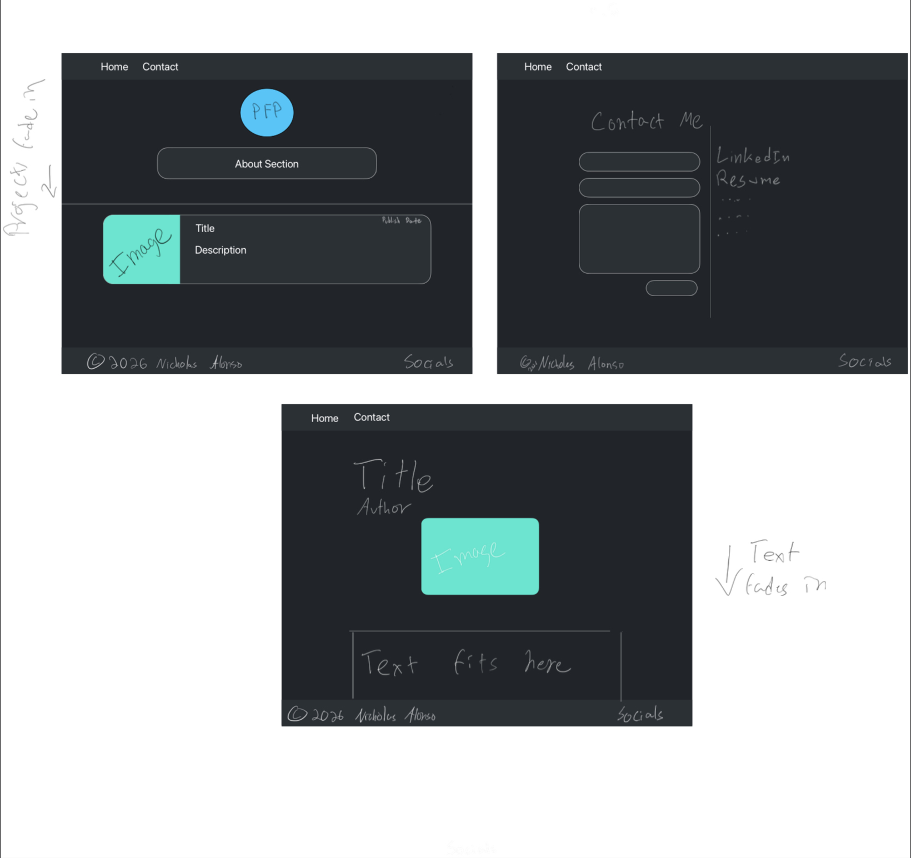
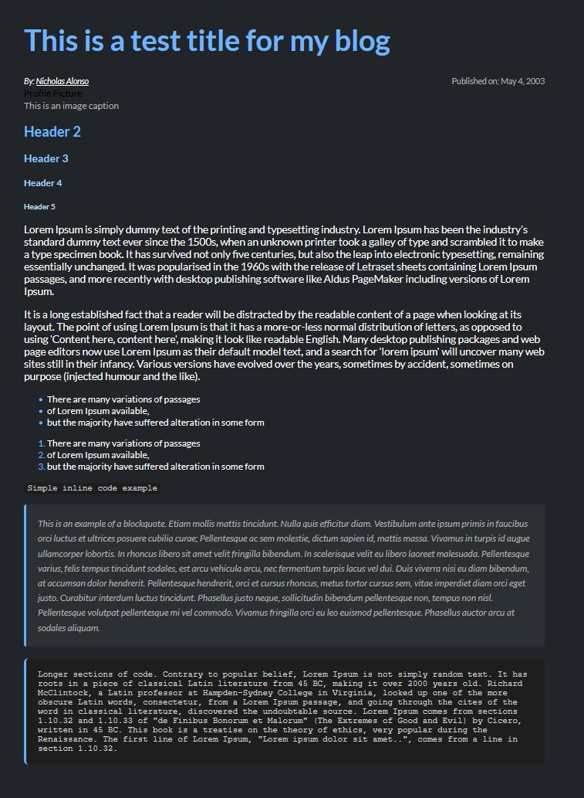

## Welcome to my website!

Hello, as you have probably gathered from the title of this post, this is my new website. I have had a website for a couple of years now but I hadn't really done anything with it and I ended up abandoning it. Part of the reason I abandoned my initial website was because I wasn't very happy using WordPress to manage my site. Don't get me wrong, WordPress is an amazing tool, but I felt it was too restrictive and clunky for what I wanted, so I decided to just make my own from the ground up!

## Background

I've never actually created a website in HTML and CSS before, at least not without lots of help from LLMs. I gained some experience with HTML and CSS through design sprints for my UX design classes, where I created UX design prototypes with a group. The bulk of those projects were vibe-coded but I did tweak a lot of things manually since the AIs would sometimes have trouble understanding exactly what I wanted.

Those small bits of manual intervention led me to realize that it isn't really that hard to do by hand. I was also in the process of fixing up many broken components of my family's business website built in WordPress — there were things I wanted that the Elementor editor couldn't handle directly, so I'd just code those parts in manually. So when it came time to redesign my personal site and I looked through hundreds of prebuilt themes offering WAY too much for what I wanted, I knew coding it by hand was the way to go. In this post I'll go over how I designed my website, the challenges I ran into, and what's still to come.

## Step 1. Planning

I decided to do what I admittedly have failed to do on many projects before — actually plan things out. I already had a rough idea in my head of what I wanted, so I made a diagram in Freeform and chose colors and a general layout.



My goal was simple: develop something that looks nice, is easy to navigate, and just works. Sure there are very impressive sites out there, but I've always had an appreciation for simple designs that don't overcomplicate things. I'm also not a web developer by any means, so something simple was the way to go.

I ended up not implementing the Contact page since I thought it was too much complication to add a separate contact system when I have all my socials displayed front and center. I was also concerned about spam through a contact form, much like I received on the previous version of my site. On the sides of the mockup you can see notes about animations I wanted to implement — I still plan on doing that but I have zero experience with JavaScript so I decided to leave it for later.

While designing my layout, I realized I had no easy way to make posts. I wasn't familiar with Content Management Systems at the time, so when it came time to think about blog posts I settled on just making a new HTML file every time I wanted to write one. Then I opened up VSCode and quickly realized why that is a HORRIBLE idea. So I did what anyone does these days and conferred with Claude on the best solution.

Claude brought up Hugo, a Static Site Generator that isn't actually a CMS but was capable of doing exactly what I wanted. I had come across Hugo before but was under the impression it was similar to WordPress — that it had its own themes and those were the only ones I could use. This obviously went against what I wanted, but after Claude's assurances that it would "just work" with my design I decided that was enough research and trusted it. I should've done more of my own research, but I was eager to get started and just went for it. Not a big mistake, but it definitely contributed to a lot of the issues I'll touch on later.

## Step 2. Designing

This was actually the most straightforward — but time consuming — part of the entire project. The whole development process lasted around 16 hours, with the bulk of the code written from scratch. I created my homepage and a style guide page. The style guide was intended for me to style as many things as I could think of in CSS, so that when I was ready to write a blog post I'd already know how my site would look.



I had Claude help out with responsiveness since I really struggled to adapt the site to different devices. Claude was able to take care of those issues easily and after a weekend of work I was done with the design. In my CSS file I commented around the sections Claude handled for transparency. I also structured my HTML to be screen reader friendly and used the WAVE tool by WebAIM to make sure all colors had appropriate contrast to satisfy WCAG AAA requirements.

I've always liked the idea of making software accessible to everyone, so I brought that mentality into my website. Even if only one person benefits from it, it was worth the implementation.

## Step 3. Implementation

This is the part where I ran into all sorts of trouble. After I had my two HTML files and CSS file, I decided now was the time to implement Hugo. Like Claude said, just install it, put in a couple lines of code, and we're ready to go live — right? When I went back to Claude and asked how exactly the process worked, it informed me that it was wrong, and that if I wanted to use my own design I actually had to massively overhaul my site and that it may be more trouble than it's worth.

At this point I was on the second day of developing my website with almost no breaks and it was around 11PM — I just wanted to make my site public and be done with it, and my dreams were seemingly crushed! I spent the next 2 hours reading Hugo's documentation without understanding much, asking various LLMs to walk me through converting my site only for them to get it massively wrong. The information overload and brain fog fully kicked in and I decided to take the defeat and leave it for the next day.

The next day I sat down with a clear head and carefully read through Hugo's documentation, only to realize it truly was simple. Hugo follows a strict file structure and my main challenge was understanding it — made harder by Claude being wildly incorrect earlier. After reading the documentation properly, I realized it's actually pretty straightforward. Hugo uses template variables to identify things like titles and author names, referred to as "front matter." Once you put these template variables into the appropriate section of your HTML file, Hugo handles the rest. New markdown files use your front matter fields and everything after that is your content.

Then just run:

```
hugo
```

Hugo creates a `public/` folder. Upload those files to your hosting provider's `public_html` and you have a working site. In my case I uploaded my files to a GitHub repo and used the Git version control feature in cPanel, but you could really do it however works best for you. I also realized I needed a way to create the project cards on my homepage — a bit more digging revealed this could be handled similarly to blog posts but with a YAML file instead of markdown, which was very straightforward. Now whenever I want to upload a post I write it in markdown, create the card in my YAML file that links to it, and upload those files. (Note: the process is a bit more tedious than this but I'm already working on a way to speed it up!)

I don't want to downplay the work that went into this — I learned all of this after another 5-6 hours of researching and almost giving up on Hugo altogether. Total development time was around 22-23 hours, but for my first time actually programming a website I think the time spent was fair, and the end result is something I'm extremely proud of.

## So what's next?

This site is by no means finished. There's still a lot I want to implement — proper scroll animations between sections instead of the abrupt snap that happens when clicking header buttons, an index for longer posts so readers can jump to the section they're most interested in, a page with all my posts and the ability to filter by tags, and plenty of other things I'll think of down the line.

Like many projects, this website will probably never be truly done and will go through many changes. I'll document those changes as I go and as my IT and cybersecurity journey evolves, this site will evolve with it.

For now though, I just hope you enjoyed reading through this and take some inspiration from it — go out and build what you want, even if you're unsure of how the end result will look!
